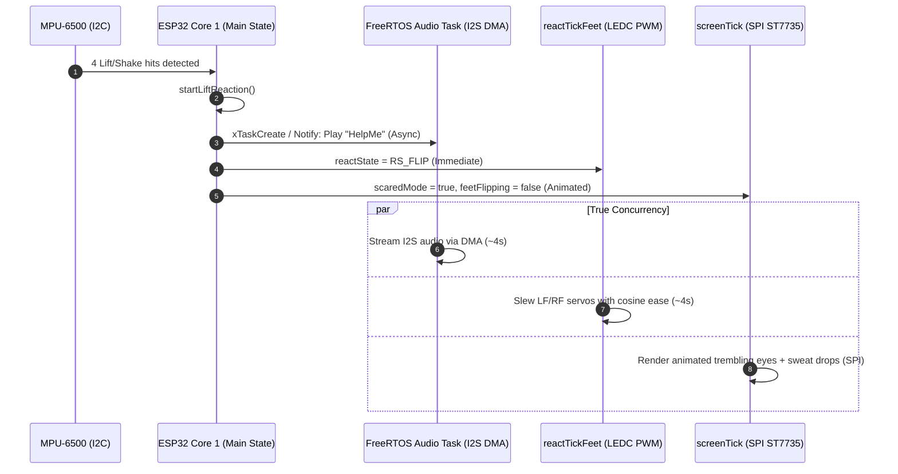

# Architectural Analysis & Improvement Plan: TTS Audio Latency and Shake/Fear Reaction Concurrency

## Executive Summary
This document provides a deep-dive analysis of two core performance/behavioral challenges in the **Bob robot platform** across [`BOB_ROBO_CONVO`](BOB_ROBO_CONVO/server.py:1) (Python host) and [`BOB_V2/Otto_ESP32S3`](BOB_V2/Otto_ESP32S3/Otto_ESP32S3.ino:1) (ESP32-S3 firmware):
1. **TTS Audio Latency**: Why text appears on screen immediately after Ollama LLM response, but takes a noticeable delay before playing on the robot speaker.
2. **Shake/Fear Reaction Concurrency**: Why Motor, Screen (TFT), and Speaker currently run sequentially rather than simultaneously, and how to achieve true concurrency (software vs hardware requirements).

---

# Part 1: TTS Audio Latency Breakdown

## 1. End-to-End Pipeline Trace

When Bob interacts in conversation mode ([`BOB_ROBO_CONVO/server.py`](BOB_ROBO_CONVO/server.py:985)):
```
[User Speech Ends]
   │
   ▼
[Whisper STT (Local Transcribe)] (~100-300ms)
   │
   ▼
[Ollama LLM JSON Generation] (~500-1500ms)
   │
   ├─► 1. UI Display Updates (FIRE-AND-FORGET HTTP GETs, 10-20ms)
   │     • _dash.add_message("bob", reply_text)
   │     • /setexpression (TFT face update)
   │     • /setticker (TFT text ticker)
   │     • /showscreen?name=speak
   │     ===> USER SEES TEXT IMMEDIATELY ON DASHBOARD & ROBOT TFT SCREEN <===
   │
   └─► 2. TTS Generation & Playback (BLOCKING PIPELINE, 1000-2500ms+)
         • Phrase chunking in Python: splits reply into ~90 char chunks
         • Sequential macOS `say` execution: text → AIFF
         • Sequential `ffmpeg` transcoding: AIFF → mono 16-bit PCM @ 16kHz + filters
         • Sequential HTTP POST multipart upload to `/mactts` on ESP32
         • ESP32 PSRAM upload buffering: collects full chunk in PSRAM
         • ESP32 I2S DMA playback from PSRAM
         ===> USER HEARS AUDIO AFTER 1-3 SECOND DELAY <===
```

## 2. Root Causes of the Perceived Delay

### Bottleneck A: Sequential "Render All Chunks Before Uploading" (Primary Software Culprit)
In [`BOB_ROBO_CONVO/lib/robo_tts.py:195-203`](BOB_ROBO_CONVO/lib/robo_tts.py:195):
```python
# 1) render everything up front
rendered: list[tuple[Path, float]] = []
for i, phrase in enumerate(phrases):
    src = _render_to_aiff_or_wav(phrase, tmp)   # Subprocess spawn: macOS `say` (~150ms)
    wav = tmp / f"chunk_{i}.wav"
    dur = write_pcm_wav(_to_pcm(src), wav)      # Subprocess spawn: ffmpeg (~150ms)
    rendered.append((wav, dur))

# 2) upload back-to-back
for i, (wav, dur) in enumerate(rendered):
    _send_wav(wav, dur)                         # Upload over WiFi (~100-200ms)
```
- For a multi-sentence response with 4 chunks, Python blocks for `4 * (150ms say + 150ms ffmpeg) = ~1200ms` just creating files on disk **before the very first byte is even sent to the robot**.

### Bottleneck B: Asynchronous Screen Display vs Synchronous Audio Flow
- Display commands (`/setexpression`, `/setticker`) are dispatched instantly as fire-and-forget HTTP requests taking <15ms.
- The screen shows the text at `T = 0ms`, while the audio pipeline only begins rendering at `T = 0ms` and finishes transmitting at `T = 1200-2000ms`.

### Bottleneck C: Non-Streaming ESP32 Buffer-Then-Play Model
In [`BOB_V2/Otto_ESP32S3/Otto_ESP32S3.ino:3479-3549`](BOB_V2/Otto_ESP32S3/Otto_ESP32S3.ino:3479):
- The ESP32 `/mactts` endpoint receives the whole multipart WAV, buffers all PCM bytes into PSRAM (`mttBuf`), and only starts calling `i2s_write()` upon `UPLOAD_FILE_END`.
- While this prevents I2S buffer underruns on flaky WiFi, it adds the full upload transfer duration to the playback latency.

## 3. Actionable Improvements to Minimize TTS Latency

1. **Pipelined / Producer-Consumer TTS Generation**:
   - Change `robo_tts.py` so that **Chunk 0** is rendered and uploaded immediately to start playing while Background Thread renders **Chunk 1, Chunk 2...** in parallel.
   - Initial audio playback starts in ~200-300ms instead of 1500ms.
2. **Fast In-Memory Transcoding / Faster TTS Synthesis**:
   - If using macOS `say`, avoid disk round-trips and multi-stage ffmpeg processes where possible, or use a streaming TTS engine (e.g., Piper TTS, Kokoro, or pre-warmed subprocess pipes).
3. **Optimized Audio Format**:
   - Render directly to raw PCM16 at target sample rate without intermediary AIFF + ffmpeg chain.
4. **Synchronized Display Option**:
   - If strict visual-audio synchronization is desired, delay the TFT ticker start or pacing until the first audio chunk starts playing.

---

# Part 2: Shake / Fear Reaction Concurrency Analysis

## 1. Why Motor, Screen, and Speaker Don't Run Simultaneously Today

In [`BOB_V2/Otto_ESP32S3/Otto_ESP32S3.ino:4759-4794`](BOB_V2/Otto_ESP32S3/Otto_ESP32S3.ino:4759):
```cpp
void startLiftReaction() {
  reactState     = RS_FLIP;
  scaredMode     = true;
  feetFlipping   = true;   // Flag disables screenTick face animations!

  drawFaceNow();           // 1. Paints static scared face once
  prevExpr = expression;

  if (helpMeEnabled) {
    playHelpMe();          // 2. BLOCKING audio playback (~4 seconds!)
  }

  reactStart = millis();   // 3. Feet ONLY start wiggling after audio finishes!
}
```

### The Three Architectural Reasons for Sequential Execution:
1. **Blocking Audio Function**: `playHelpMe()` runs a synchronous loop pumping bytes into I2S until the file completes (~4s). Nothing else in `loop()` runs during this time.
2. **`feetFlipping` Animation Freeze**: During `RS_FLIP`, the animated sweat drops / eye shivers are disabled (`feetFlipping = true`) to prevent SPI bus traffic from colliding with servo PWM loop passes.
3. **IMU I2C Bus Protection**: During servo slewing, sudden motor currents induce ground bounce and electrical noise on the shared I2C bus lines (SDA/SCL on GPIO 46/0). The firmware deliberately disables IMU polling (`imuPollOk = false`) during `RS_FLIP` to prevent the ESP32 I2C peripheral from wedging.

## 2. Hardware vs Software Feasibility for Simultaneous Playback

### Hardware Capabilities of ESP32-S3:
- **Dual-Core Xtensa LX7 @ 240MHz**: Core 0 runs WiFi/Network; Core 1 runs Arduino application loop / tasks.
- **Dedicated Hardware Peripherals**:
  - **Servos**: LEDC hardware PWM generator (Channels 0-3 on Timers 0-1) runs autonomously once pulse width is set.
  - **Speaker (MAX98357A)**: I2S0 DMA controller streams audio autonomously without CPU byte-by-byte pumping.
  - **Display (ST7735)**: SPI master (MOSI1, SCK2, CS21, DC42).

**Conclusion**: **No new hardware/wiring is strictly required to achieve simultaneous motor movement, speaker sound, and screen expression**, but electrical decoupling precautions are critical.

### Potential Electrical / Hardware Vulnerabilities:
- **Power Brownouts / Noise**: Running 4 servos simultaneously with the MAX98357A Class-D amplifier at max volume draws peak currents (>1.5A - 2A). If sharing a weak 5V/3.3V rail or USB power, voltage dips can reset the ESP32 or cause speaker popping.
  - *Hardware requirement/recommendation*: Ensure common ground and dedicated power/bulk capacitor (e.g. 470µF-1000µF across servo power rails) if simultaneous motor + audio causes audio distortion or resets.

---

# Part 3: Architecture for True Simultaneous Shake/Fear Reaction



## Step-by-Step Implementation Roadmap:

1. **Firmware: Asynchronous Audio Task (`Otto_ESP32S3.ino`)**:
   - Refactor `playHelpMe()` / audio playback into a non-blocking FreeRTOS task or use I2S DMA queue.
   - `startLiftReaction()` launches the sound task in the background and immediately starts `reactTickFeet()`.
2. **Firmware: Non-Blocking Animated Face During Motion**:
   - Allow `scaredAnimTick()` to keep updating the display during `RS_FLIP` by removing the restrictive `feetFlipping` block, or pacing TFT frames every 80-100ms so SPI traffic is brief and non-interfering.
3. **Python / BOB_ROBO_CONVO Synchronization (`server.py`)**:
   - When the server detects `scared_now`, dispatch `/setexpression` and start audio without holding the thread from coordinating other actions.
4. **TTS Pipelining (`robo_tts.py`)**:
   - Implement streaming / overlapping chunk synthesis so speech starts on the robot speaker immediately after Ollama finishes generating the first sentence.
